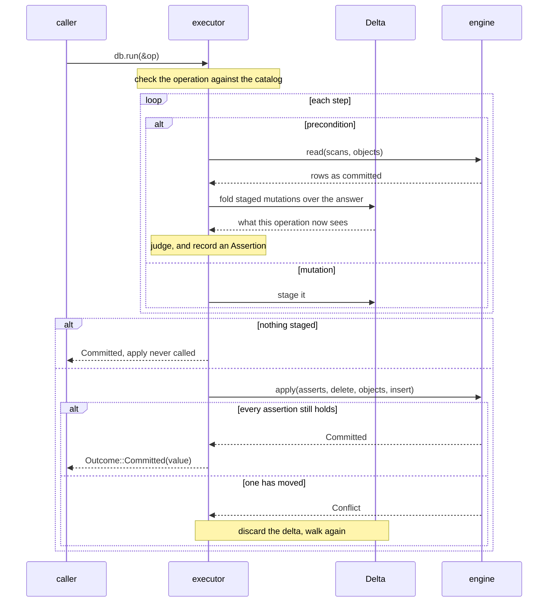

# How DocLite stores and finds things

DocLite is an embeddable document store whose transactions are values. There is
no `begin`, no `commit`, and no transaction handle.

If you have used any other storage library, those absences will read as an
omission, so this post walks the whole thing in order: what the store holds, how
you put something in, how you get it back out, and what actually happens between
the two.

Every code sample here is lifted from
`crates/doclite-testkit/src/programs.rs`, which passes against every engine.
Assertions are trimmed to the interesting line and setup is elided; nothing is
rewritten.

## What the store holds

Two things, and the store decides nothing about either.

A **object** is bytes under an `ObjectId` you minted. Objects are only ever
inserted. There is no update and no delete, so an engine that already holds an
id refuses the insert with `StorageError::DuplicateObject` rather than
silently overwriting.

An **index row** is a tuple of columns and the object it names. Index rows are
inserted and deleted freely, and a whole range retires in one step.

That asymmetry is the design. An object is a fact that happened; an index is a
way of finding one. An index can be rebuilt from the objects it names, which
is why losing one is recoverable and losing an object is not.

An index carries no constraint. `IndexSchema` says which index it is and how
wide a key is, and nothing else. Whether at most one object may hold a key is
a rule, and rules are asserted by an operation rather than declared on an index.
More on that below.

You mint the ids yourself:

```rust
let id = ObjectId(7);
```

Monotonicity, node identity and collision avoidance belong to the layer that
knows what an object means. The store never reads an `ObjectId` as anything
but bytes to compare and a key to look under. This is also what makes an
operation fully describable before it runs, which is what makes retry free.

## Adding things

An `Operation` is a transaction's worth of work, built as a value:

```rust
let id = ObjectId(7);

let op = Operation::new()
    .require_absent(&USERS_BY_EMAIL, exact(key!["a@b.c"]), DUPLICATE_EMAIL)
    .put_object(id, b"a blob".to_vec())
    .put_index(&USERS_BY_EMAIL, key!["a@b.c"], id)
    .returning(id);

db.run(&op).await?;   // Outcome::Committed(id)
db.run(&op).await?;   // Outcome::Aborted(DUPLICATE_EMAIL)
```

`run` is the transaction boundary. Steps apply in written order, all of them or
none.

Superseding an object is not a special operation. It is a delete of the old
index rows plus an insert of the new ones, written out:

```rust
let replace = Operation::new()
    .require_absent(&USERS_BY_EMAIL, exact(key!["new@b.c"]), DUPLICATE_EMAIL)
    .put_object(new, b"second".to_vec())
    .delete_index(&USERS_BY_EMAIL, exact(key!["old@b.c"]))
    .put_index(&USERS_BY_EMAIL, key!["new@b.c"], new)
    .returning(new);
```

The old object is still there. Nothing in this layer frees the space it
occupies. A layer above that wants retirement models it as an ordinary indexed
field, because a tombstone would be erasure wearing an append's clothes.

Two operations built by different modules merge into one transaction:

```rust
let patient = Operation::new()
    .put_object(id, b"patient".to_vec())
    .put_index(&PATIENTS, key!["clinic-a", id], id);

let account = Operation::new()
    .require_absent(&USERS_BY_CI, exact(key!["111"]), DUPLICATE_CI)
    .put_index(&USERS_BY_CI, key!["111"], id)
    .returning(id);

db.run(&patient.then(account)).await?;
```

`then` concatenates step lists. The result is still one `Operation`, so it is
still one transaction. That is what replaces the delimiters: a boundary you can
pass around and combine, rather than a pair of instructions to get wrong.

## Keys, indexes, and encoding

An index is declared once, and its arity is part of its type:

```rust
static USERS_BY_EMAIL: Index<1> = Index::new("users_by_email");
static APPTS: Index<3> = Index::new("appts_by_doctor_date_time");
```

Then handed to `Db::open`, which is the only place the catalog is set up:

```rust
let db = Db::open(MemoryEngine::new(), &[USERS_BY_EMAIL.schema(), APPTS.schema()]).await?;
```

Carrying the arity as a const parameter turns "this key has the wrong number of
components" from a runtime refusal into a compile error. `key![..]` builds a key
and counts its components the same way:

```rust
key!["a@b.c"]                     // Key<1>
key!["dr-a", "2026-08-26"]        // Key<2>, a partial key over an arity-3 index
```

The caller encodes. `ToOrdBytes` turns a value into bytes whose `memcmp` order
is the value's own order, and an engine compares those bytes and never
interprets them. Unsigned integers are big-endian. Signed integers are the same
with the sign bit flipped, which turns two's complement into an unsigned
ordering. Strings and byte strings are themselves.

Settling this in one trait rather than per engine is the point. Otherwise a
compound key over mixed types becomes a comparison function every backend has to
agree on and nobody can test in one place.

A compound key is one byte string per column, never a concatenation. That means
no escaping is needed: columns compare element by element, so one column cannot
bleed into the next. It also means a partial key compares as a prefix, which is
what makes `prefix` and a partial `between` select whole groups of an index.

The cost is real and worth naming. Reading a column back means knowing what it
was. `RowKey::component` hands you bytes, and the layer that wrote them is the
one that can decode them.

## Querying

A `Query<T>` is a read that knows what it will produce. There are three shapes.

```rust
Query::object(id)                     // Query<Option<Vec<u8>>>
Query::count(&USERS_BY_EMAIL, all())    // Query<u64>
Query::scan(&APPTS, prefix(key!["dr-a", "2026-08-26"]))   // Query<Vec<Row>>
```

Ranges come in four kinds, and the type checks them against the index:

```rust
exact(key!["a@b.c"])                                  // the whole key, nothing else
prefix(key!["dr-a", "2026-08-26"])                    // every key starting with these
between(key![lo], key![hi], Bound::Incl, Bound::Excl) // a window
all()                                                 // every row
```

A `Range<N, K>` carries two const parameters: the arity of the index it reads,
and the number of components in the key it was built from. `exact` on a partial
key and `prefix` with more components than the index has are both compile
errors, not refusals at run time.

A scan comes back in the index's own order, and can fetch each row's object:

```rust
let query = Query::scan(&APPTS, prefix(key!["dr-a", "2026-08-26"]))
    .limit(500)
    .with_objects::<Vec<u8>>();

let found = db.run(&query).await?.committed().expect("every row names an object");
for (row, body) in found {
    let time = row.key.component(2);   // straight out of the key, no object read
}
```

Reading a column out of the key is often the whole answer. The index already
holds it, so there is no object to fetch.

An index row can name an object that is not there. That is a decision on the
builder rather than an error you handle later:

```rust
Query::scan(&APPTS, all()).limit(10).with_objects::<Vec<u8>>();
// -> Outcome::Aborted(AbortCode::DANGLING_INDEX_ENTRY)

Query::scan(&APPTS, all()).limit(10).with_objects_lenient::<Vec<u8>>();
// -> Outcome::Committed(rows), the missing body is None
```

Several reads that have to agree with each other are one query:

```rust
let both = Query::zip(
    Query::count(&USERS_BY_EMAIL, all()),
    Query::object::<Vec<u8>>(id),
);
db.run(&both).await?;   // Outcome::Committed((1, Some(b"a blob".to_vec())))
```

`zip` is what replaces "several reads in one program". The plan tree is
flattened so every scan and every object id goes to the engine in one call and
is answered from one view, which is the only reason the two halves can be
trusted to agree. It nests, so four consistent reads stay one expression.

One thing sits outside that view. A scan that also wants objects needs a
second call, because which objects to fetch is not known until the first one
answers. A row whose object went missing in between is the dangling case
above, which already has an answer.

### Objects as values

Everything above stores and reads `Vec<u8>`, because that is what an engine
holds. A caller almost always has a struct, and two traits sit between them:
`ToStorage` on the way in, `FromStorage` on the way out. `Vec<u8>` implements
both as the identity, so the byte API above is a use of the same traits rather
than a separate thing.

A type that already derives serde's `Serialize` and `Deserialize` opts in with
one line:

```rust
#[derive(Serialize, Deserialize)]
struct User { email: String, visits: u32 }

doclite_core::serde_storage!(User);
```

Then it goes in and comes back as itself:

```rust
let op = Operation::new()
    .put_object(id, &user)
    .put_index(&USERS_BY_EMAIL, key![user.email], id);

db.run(&Query::object::<User>(id)).await?;   // Committed(Some(user))
```

The encoding is CBOR, behind a `cbor` feature. That choice follows from
objects being append-only: one written before the struct gained a field is
never rewritten, so it has to still decode afterwards, and only a
self-describing format gives that. A smaller encoding like bincode would break
every existing object the first time a field is added.

There is a second self-describing format, and `json_storage!` is its macro. It
costs size and buys a store that something other than this crate can read,
which is what the document layer's `#[storage(json)]` reaches for: under the
SQLite engine such an object is a text value rather than a blob, so `sqlite3`
prints it and `json_extract` reads a field out of it. The append-only argument
above is what both formats satisfy and is why neither is something smaller.

`put_object` encodes when the operation is built rather than when it runs, so
a value that cannot be encoded is a defect in the operation and is refused
before an engine is asked anything. Reading an object back as the wrong type is
`StorageError::Decode`, which is separate from `ReadMismatch` because the read
itself was fine and the caller named the wrong shape.

A type that wants an encoding of its own writes `impl ToStorage for Blob`
directly. That is why the serde path is a macro rather than a blanket impl over
`Serialize`: a blanket would leave no room for it.

## Iterating with `for_each`

Everything so far is known before the operation runs. Reindexing is not: you
have to read rows and write something derived from each one.

```rust
let reindex = Operation::new().for_each(
    Query::scan(&PATIENTS, prefix(key!["clinic-a"])).limit(1000),
    |row| Operation::new().put_index(&PATIENTS_V2, key![row.key(0), row.doc()], row.doc()),
);
```

Cascade delete has the same shape:

```rust
let cascade = Operation::new().for_each(
    Query::scan(&PATIENTS, prefix(key!["clinic-a"])).limit(1000),
    |row| Operation::new().delete_index(&NOTES_BY_PATIENT, exact(key![row.doc()])),
);
```

This is the one sharp edge in the API, and it is worth understanding rather than
pattern-matching.

**The body runs once, at build time.** It is called with a symbolic `RowRef`
before any row exists. What comes back is a template the executor instantiates
per row, not a callback invoked per row.

**A template can construct and cannot branch.** `row.key(0)` hands back a `Cell`
and `row.doc()` an `ObjectCell`. Neither carries `PartialEq` or `Ord`, so there is
nothing to compare against and the comparison is unwritable. That restriction is
what keeps the operation a value the engine can still inspect and re-run.

**The scan must carry a limit.** `for_each` is the only combinator that can do
unbounded work. An unbounded one is refused before it touches an engine:

```rust
// the same body, but the scan carries no limit
let reindex = Operation::new().for_each(Query::scan(&PATIENTS, all()), |row| {
    Operation::new().put_index(&PATIENTS_V2, key![row.key(0), row.doc()], row.doc())
});

db.run(&reindex).await;
// -> Err(StorageError::Invalid(BuildError::UnboundedForEach))
```

`for_each` does not nest, for the same reason.

## Preconditions instead of constraints

No index enforces uniqueness. An operation asserts it, and carries the code to
report when the assertion fails:

```rust
const DUPLICATE_EMAIL: AbortCode = AbortCode::new(100);
const DUPLICATE_CI: AbortCode = AbortCode::new(101);

Operation::new()
    .require_absent(&USERS_BY_EMAIL, exact(key![email]), DUPLICATE_EMAIL)
    .require_absent(&USERS_BY_CI, exact(key![ci]), DUPLICATE_CI)
    .put_object(id, b"blob".to_vec())
    .put_index(&USERS_BY_EMAIL, key![email], id)
    .put_index(&USERS_BY_CI, key![ci], id)
    .returning(id)
```

Adding a third unique field is one more line, and the caller learns which one
failed rather than parsing a backend's error string. There are three
preconditions: `require_absent`, `require_count`, and `require_object`.

The return type is the other half of this:

```rust
Result<Outcome<T>, StorageError>

pub enum Outcome<T> {
    Committed(T),
    Aborted(AbortCode),
}
```

A duplicate email is `Ok(Aborted(DUPLICATE_EMAIL))`, because the operation did
exactly its job. A failed write is `Err`, because it did not. Codes at or below
`AbortCode::RESERVED` belong to the crate; yours start above it.

A refused operation stages nothing:

```rust
let op = Operation::new()
    .require_object(ObjectId(404), NO_SUCH_USER)
    .put_index(&USERS_BY_EMAIL, key!["a@b.c"], ObjectId(404));

db.run(&op).await?;                                    // Aborted(NO_SUCH_USER)
db.run(&Query::count(&USERS_BY_EMAIL, all())).await?;  // Committed(0)
```

## How a commit actually happens

Now the part that explains the missing `begin`.

An operation reads and then commits, and those are two separate calls on the
engine. Something has to carry consistency across the gap. The usual answer is a
transaction handle the executor drives step by step, and it is the wrong price
here. A handle has to name a backend type this crate cannot name, it breaks
object safety, and a single-connection engine deadlocks on the first read taken
inside one.

So nothing is held. Here is what happens instead.

### The walk

The executor walks the step list once, keeping a `Delta` of everything staged so
far. A mutation goes into the delta and nowhere else. A precondition reads the
engine, folds the delta over the answer, and judges the result.

That fold is read-your-own-writes, and it is why a precondition placed after a
mutation sees it:

```rust
let holds = Operation::new()
    .put_index(&USERS_BY_EMAIL, key!["a@b.c"], ObjectId(1))
    .require_count(&USERS_BY_EMAIL, exact(key!["a@b.c"]), 1, INVARIANT);
db.run(&holds).await?;    // Committed

let blind = Operation::new()
    .put_index(&USERS_BY_CI, key!["111"], ObjectId(1))
    .require_absent(&USERS_BY_CI, exact(key!["111"]), INVARIANT);
db.run(&blind).await?;    // Aborted(INVARIANT), and nothing was written
```

Preconditions and mutations are one list, not two. There is no typestate
separating the halves, because separating them would cost exactly this.

The delta is replayed in written order rather than collapsed, because a delete
and an insert over the same key mean opposite things depending on which came
first.

### What each observation records

Every precondition also records an `Assertion`: the condition the batch will be
refused for no longer holding.

An assertion records what the step actually looked at, and no more:

| Situation | Recorded as |
|---|---|
| index untouched, `require_absent` | `Observed::Absent` |
| index untouched, `require_count` | `Observed::Count(n)` |
| anything staged against that index | `Observed::Rows(..)`, the whole committed set |

The narrowing in the third row is forced. Once the operation has staged
something against an index, the committed count alone no longer describes what
the step saw, so the whole row set is asserted instead.

Recording no more than was observed is what keeps a `require_count` on a busy
range from conflicting with every unrelated writer. An assertion that said "and
nothing else about this index changed" would be correct and useless.

### The commit

When the walk finishes, the delta becomes a `Batch` and goes to the engine in
one call. `apply` re-evaluates every assertion against the state **before** the
batch. If any has moved, it answers `Applied::Conflict`, the executor throws the
delta away and walks the operation again from the start.

Re-walking is free because an operation is a value with no side effects. This is
the whole reason the API refuses `db.transaction(|tx| ..)`: a closure might have
sent an email, so it can never be safely re-run.



Pre-batch evaluation is what lets one condition mean both "nothing may hold this
key" and "this key, which I am about to release", without the two wanting
different moments.

Retries are bounded. `Db::with_attempts` sets the ceiling, the default is
sixteen, and exhausting it is `StorageError::Conflict { attempts }` rather than
a silent failure. Concurrency here is optimistic, so a hot key costs re-walks.

### The batch is ordered

A `Batch` carries four things, and the order is the contract:

1. every assertion, evaluated against pre-batch state
2. index row deletes
3. object inserts
4. index row inserts

Deletes before inserts looks wrong against "written order", and it is
reconciled before the engine ever sees the batch. `Delta::into_batch` drops any
insert that a later delete covers. What reaches the engine is already free of
the conflict, so an engine can apply every delete first and still get the
written order's meaning.

The in-memory engine is the shortest correct implementation of this, and it is
worth reading: `State::admits` decides everything that can fail before anything
moves, and `State::commit` cannot fail at all. Atomicity there is that ordering
and nothing else.

### The lock mode falls out

There is no read-only flag on the trait. An operation with nothing staged never
reaches `apply`, so an engine takes its write lock in exactly one method. The
method split is the lock-mode decision, made one layer earlier than a flag would
have made it.

## What an engine is told

One last thing, because it explains why the executor filters answers it already
asked to have filtered.

`Engine` has three methods you have to write, `define`, `read` and `apply`, and
two that already have an answer. `plan` declines by default and `takes_sweep`
says no, so an engine that implements neither is complete and correct. Both are
there for a backend that can do better than being handed flat scans, and both
can only save work. Everything an `IndexRead` carries beyond the index itself is
a **hint** in the same sense. The test is what happens when an engine ignores
one: it returns a superset, the executor filters, and ignoring costs time rather
than correctness.

| Told | Cost of ignoring it |
|---|---|
| `range` | a superset; the executor filters |
| `limit` | every matching row; the executor trims |
| `plan` | the executor takes the read apart and does it the long way |
| `takes_sweep` | the executor expands the template itself, row by row |
| row order | the wrong answer |
| `apply` atomicity | a corrupt store |
| `apply` step order | a corrupt store |

A new engine's obligations are the three required methods. Everything below that
line it may do for speed and skip when it cannot.

This is not a comment in a header. `doclite-testkit` ships a `Probe` that wraps
any engine and blanks every hint before forwarding, and the `hints_are_hints`
property runs the same script bare and probed and demands identical transcripts.
If the executor ever stops filtering, the probed run catches it.

## The shape of it

Once control flow is data rather than a closure, most of the machinery a
transactional store usually needs stops existing. There is no begin to pair with
a commit, no rollback to call, no lock-mode flag, no handle to thread through a
call stack, and no unbalanced transaction to construct. What is left is a value
you build, hand over, and can hand over again.

Everything above is the storage layer, which holds bytes and knows no schema.
[The struct is the index](02-the-struct-is-the-index.md) covers the layer above
it, where `#[derive(Document)]` turns a struct into its own indexes, queries and
revision history. [Nothing is locked](03-nothing-is-locked.md) comes back to the
assertions and answers the question this post left open: what happens when two
writers meet. The tour continues from there; `README.md` in this directory is
the order.
