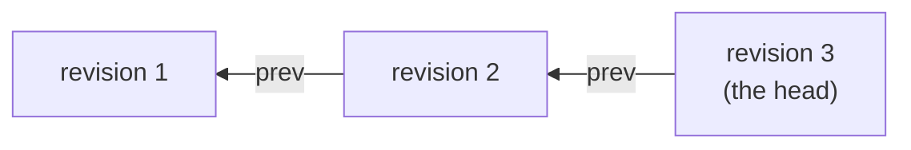
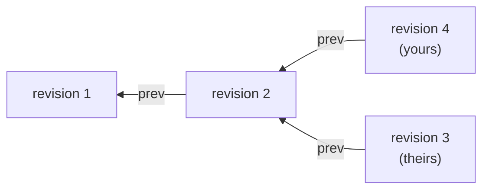

# Nothing is locked

Two people open the same record. Both edit it. Both save.

Every storage system has an answer to that, and the answer usually involves
holding something: a row lock, a transaction handle, a session that stays open
between the read and the write. DocLite holds nothing. There is no `begin`, no
`commit`, and no handle to keep alive.

This post is about what replaces it. The short version is that the read you did
becomes the condition you are held to, so the query language and the concurrency
control are the same machinery pointed in two directions. That means the queries
come first.

The [first post](01-how-doclite-stores-and-finds-things.md) walked the storage
layer and the [second](02-the-struct-is-the-index.md) walked the derive. This
one assumes both. Samples are lifted from `crates/doclite/tests/stale.rs` and
`crates/doclite-testkit/src/programs.rs`, which pass.

## A query is a description, not a program

There are four shapes a read can take, and that is the whole list:

```rust
Query::count(&index, range)                  // u64
Query::object(id)                            // Option<T>
Query::scan(&index, range)                   // Vec<Row>
Query::zip(left, right)                      // (A, B)
```

`scan` takes a `.limit(n)` and a `.with_objects::<T>()`. That is everything.

Look at what is missing. There is no predicate over what a row contains, no
projection, no ordering choice, no aggregate beyond counting, no `DISTINCT`, and
no join. A range selects on leading key bytes and nothing else:

```rust
exact(key!["a@b.c"])                    // this whole key
prefix(key!["dr-a", "2026-08-26"])      // every key starting with these
between(key![lo], key![hi], Incl, Excl) // a window
all()                                   // every row
```

If you want rows where `age > 18 AND city = "Asuncion"`, you need an index whose
key starts with those columns. There is no filtering step to fall back on,
because there is nothing in a row to filter on: a row is key bytes and an object
id. The object's contents are not visible to the read.

This reads like a limitation and it is, but it is the load-bearing kind. A read
that cannot branch on what it finds is a read you can write down completely
before running it. Hold that thought.

### `zip` is one view, not a join

Two reads that have to agree with each other are one query:

```rust
let both = Query::zip(
    Query::count(&USERS_BY_EMAIL, all()),
    Query::object::<Vec<u8>>(id),
);
```

The plan tree is flattened so every scan and every object id reaches the engine
in one call, answered from one view of the store. That is the only reason the
two halves can be trusted to describe the same moment.

It is not a join. The halves are never compared or correlated; you get a tuple
of two independent answers. A join is a scan of one index, because a
`DocumentId` is an index column like any other:

```rust
// Deal declares `#[index] account: DocumentId`
let theirs = Deal::query(&conn).by_account(account.id()).get_many().await?;
```

The other direction is the one to watch. There is no `by_id` on a query builder,
because the builder only knows the indexes the struct declared and a record does
not carry its own id as a field. Going from a `DocumentId` back to the record is
a prefix scan of its generated index followed by a fetch, which the raw API can
express and the builder does not.

## The read contract: a superset, never a subset

An engine is told the range and the limit of a scan. It is allowed to ignore
both.

| Told | Cost of ignoring it |
|---|---|
| `range` | a superset comes back; the executor filters |
| `limit` | every matching row; the executor trims |
| `plan` | the executor takes the read apart and does it the long way |
| `takes_sweep` | the executor expands the template itself, row by row |
| row order | the wrong answer |
| `apply` atomicity | a corrupt store |
| `apply` step order | a corrupt store |

The first four are hints, and an engine that implements none of them is
complete. The last three are not hints. An engine that returns too many rows is
slow; an engine that returns too few, or in the wrong order, is wrong.

This is not a promise anyone has to take on trust. `doclite-testkit` ships a
`Probe`, an engine wrapper that blanks every hint before forwarding: the range
becomes "everything" and the limit disappears. The conformance suite runs the
same script bare and probed and demands identical transcripts. An engine that
quietly depended on being told the range fails there rather than in production.

## A precondition is a query you were held to

Here is the hinge.

```rust
Operation::new()
    .require_absent(&USERS_BY_EMAIL, exact(key![email]), DUPLICATE_EMAIL)
    .put_object(id, blob)
    .put_index(&USERS_BY_EMAIL, key![email], id)
```

`require_absent` names an index and a range. So does `Query::scan`. They are the
same description; the precondition just adds what you expect to find and an
abort code for when you do not.

Steps are one ordered list. Preconditions and mutations interleave, and a
precondition placed after a mutation sees it, because the executor folds
everything staged so far over the engine's answer before judging:

```rust
Operation::new()
    .put_index(&USERS_BY_EMAIL, key!["a@b.c"], ObjectId(1))
    .require_count(&USERS_BY_EMAIL, exact(key!["a@b.c"]), 1, INVARIANT);
// Committed: the count sees the row this operation just staged
```

While it walks, the executor writes down what each precondition actually looked
at. That record is the whole of the concurrency control:

| Situation | Recorded as |
|---|---|
| index untouched, `require_absent` | `Observed::Absent` |
| index untouched, `require_count` | `Observed::Count(n)` |
| anything staged against that index | `Observed::Rows(..)`, the whole row set |

The third row is forced rather than chosen. Once the operation has staged a
change against an index, "the committed count was 3" no longer describes what
the step saw, so the full row set is asserted instead.

The narrowing matters in the other direction too. An assertion says only what
was observed, never "and nothing else about this index changed". The stronger
version would be correct and useless: a `require_count` on a busy range would
conflict with every unrelated writer touching that index.

When the walk finishes, the assertions and the staged writes go to the engine
together. The engine re-evaluates every assertion against the state before the
batch, and either applies the whole thing or reports that something moved.

## Three ways it can not work

From a caller's seat there are exactly three outcomes that are not success, and
conflating them is the main way to misuse this.

**A conflict.** An assertion stopped holding between the read and the apply.
Nothing was written. The executor discards the delta and walks the operation
again, up to sixteen times, and you never find out. There is no conflict variant
in the result type because a conflict is not an answer to your question.

Retrying is free, and specifically it is free because of choices made elsewhere.
The operation is a value with no side effects, so re-running it cannot send an
email twice. Ids are minted by the caller before the operation is built, so a
retry does not mint a new one. The clock is read once while the operation is
assembled and never during the walk, so two attempts stamp the same time. A
closure-based transaction API can make none of those promises, which is why it
cannot retry for you.

**An abort.** A precondition you wrote did not hold, and re-running would not
change that. The email really is taken. This is `Ok(Outcome::Aborted(code))` at
the storage layer, because down there the operation did its job: you asked a
question and got an answer.

The typed layer inverts it. You asked for an insert, not for a report on
whether one was possible, so a taken key is `Err(DocumentError::Duplicate {
index })` and `?` carries it. `Connection` is the one place that inversion
happens.

**An error.** The disk is gone, the bytes will not decode, or the retries ran
out: `Err(StorageError::Conflict { attempts })`. That last one is a conflict
that never cleared, and it surfaces as an error rather than an abort because
nothing about the operation was wrong.

Telling the first from the second is worth a test, which needs an engine that
loses a race on purpose:

```rust
conn.db().engine().balk(1);        // report a conflict for the next batch

let mut editing = /* ... */;
editing.shelf = 2;
let saved = conn.update(editing).await?;   // succeeds anyway

assert_eq!(saved.shelf, 2);
assert_eq!(conn.db().engine().owed(), 0, "the conflict was spent");
```

The update lost a race and landed regardless. With `balk(usize::MAX)` the same
edit exhausts the budget and comes back as `DocumentError::Storage(..)`.

A staged conflict proves the executor does the right thing with one. It says
nothing about whether a conflict happens when it should, because one thread
cannot lose a race to itself. That is a separate question and it has its own
answer: `crates/doclite/tests/contention.rs` puts eight tasks on one connection
and lets them collide for real, on both engines. They collide because `Db::run`
reads and applies in two calls, and the gap between them is wide enough to fit
another writer. One of them takes a contested unique key and the rest are told
why; eight increments of one counter all survive, each loser re-reading and
re-applying rather than overwriting.

## Up a layer: only the head is writable

Everything above is the storage layer, where a precondition is something you
write by hand. The typed layer writes one for you, and it is the reason a lost
update is not possible.

A record is a chain of revisions. An update never rewrites anything: it files a
new revision whose `prev` names the old one, retires the old index rows, and
files new ones. So after two edits the store holds this, and revision 3 is the
one queries find:



`#[derive(Document)]` emits an index nobody asked for, `<record>_latest`, keyed
on `(document, revision)` and holding exactly one row per live record. Every
update asserts against it:

```
require_count(LATEST, exact(key![document, old_revision]), 1, STALE)
```

"The revision I read is still the head." That is the whole check, and it needs
nothing but two ids. It does not care which fields you edited, whether they were
indexed, or what shape the record's own indexes are.

The revision has to be in the *key* rather than in the row's payload, because an
assertion can only ever look at key bytes. That is the read language
constraining the concurrency control, which is the same fact from the top of
this post arriving from the other side.

### The lost update, concretely

Suppose you read revision 2, then somebody else saves revision 3, then you save.

Without the check, your write would land: a revision 4 whose `prev` is 2. The
record would have two heads.



Whatever revision 3 changed is gone, silently, and the record now has two rows
in the index that is supposed to hold one per record. With the check, you get
told:

```rust
let [_, second, _] = chain(&conn).await?;   // 1 -> 2 -> 3, 3 is live

let mut editing = second;
editing.shelf = 9;
assert_eq!(conn.update(editing).await, Err(DocumentError::Stale));
```

And the thing worth asserting is not the error, it is the absence of the fork:

```rust
let live = conn
    .db()
    .run(&Query::scan(&Note::LATEST, all::<2>()))
    .await?
    .committed()
    .expect("a scan of an index this connection declared");

assert_eq!(live.len(), 1, "one record, one head");
assert_eq!(live[0].object, third.revision().0, "and the head is 3");
```

Position in the chain is all that matters. Editing revision 1 is refused for the
same reason as revision 2. The head is writable right up until it is not, so a
handle you successfully saved a moment ago is stale now. Reading is unaffected:
`history` walks back from a stale revision perfectly well. It is only writing
the past that is refused.

### Why the checks are in that order

An update builds five things in this order:

1. assert this revision is still the head
2. retire every old index row
3. assert each unique key the edited value claims is free
4. write the new revision, its `prev` naming the old one
5. file every new index row

Steps 1 and 3 are both preconditions and both could refuse the same update. The
order is not a preference. Step 1 has to come before step 2, or read-your-own-
writes shows it the delete of the very row it is counting and every update in
the system is stale. Step 3 has to come after step 2, or a record editing an
unrelated field finds its own unique key still in place and reports itself as a
duplicate. Two independent constraints, and between them there is nothing left
to decide: staleness is always reported first.

## What you do about it

`DocumentError::Stale` means somebody else got there first, and it is the one
error in this system that has an obvious response:

```rust
let mut editing = second;
editing.body = "a better body".into();
assert_eq!(conn.update(editing).await, Err(DocumentError::Stale));

let mut again = head(&conn).await?;        // re-read
again.body = "a better body".into();       // re-apply
let saved = conn.update(again).await?;

assert_eq!(saved.body, "a better body");   // the edit landed
assert_eq!(saved.shelf, 3);                // on top of what superseded it
```

Re-read, re-apply, save. What you cannot do is retry the same handle, because
`update` takes it by value and the one you were holding is exactly the thing
that went stale.

Whether re-applying is the right move is your call and nobody else's. If two
people set the same field, last writer wins is usually fine. If they are both
adding to a list, you want to merge rather than replay. The store refuses the
write and hands the question back rather than guessing, which is the part a lock
would have taken away from you by making the second person wait.

## Where this is the wrong shape

Optimistic concurrency is a bet that conflicts are rare. When they are not, this
does the worst possible thing: work is done, thrown away, and done again.

A single row that every request updates, a counter or a sequence, will spend its
life losing races. Sixteen attempts is generous for incidental contention and
useless for a hot spot. Model those as separate records that merge later, or
keep them somewhere else.

Two smaller edges are worth knowing. A scan that also wants objects needs a
second read call, because which objects to fetch is not known until the first
one answers, so those payloads sit outside the snapshot the scan was taken in. A
row whose object went missing in between is the dangling case, which aborts
rather than answering. And `history` is one read per revision rather than a
snapshot, so a chain that grows while you walk it can hand you a longer answer
than it had when you started.

## The shape of it

The absences at the top were not economies. A read that cannot branch on what it
finds is a read that can be written down, and a read that can be written down is
a precondition. Once preconditions and mutations are one list, the executor can
record what each read saw, hand the whole thing over, and let the engine judge
it against the state it will actually write into. Nothing has to be held open
because nothing was ever open.

What you give up is expressive queries. What you get is that the question "what
happens when two people save at once" has an answer you can read in five steps,
and the answer for the layer above is one generated index and one count.
